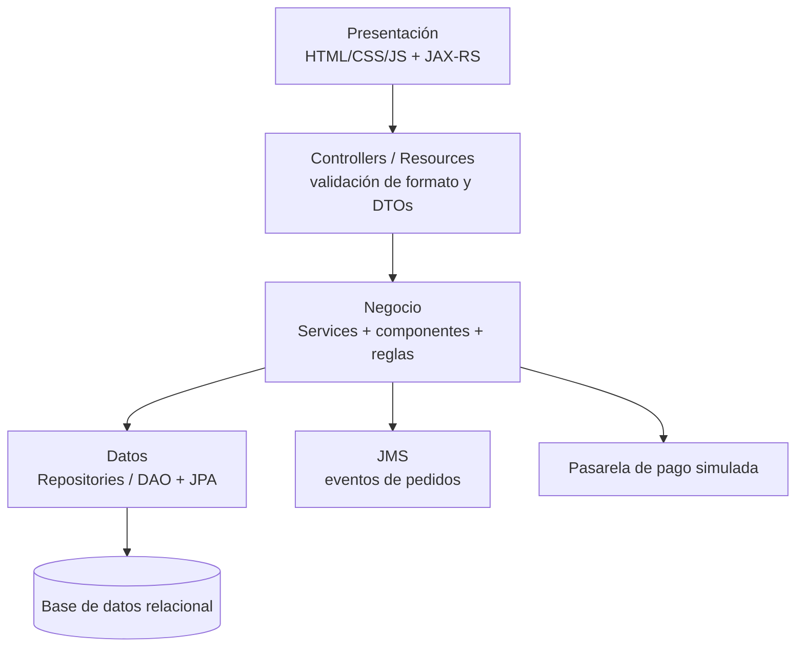
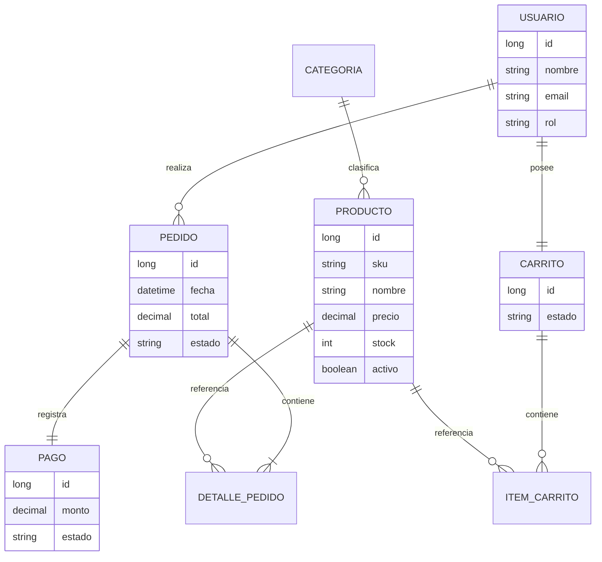
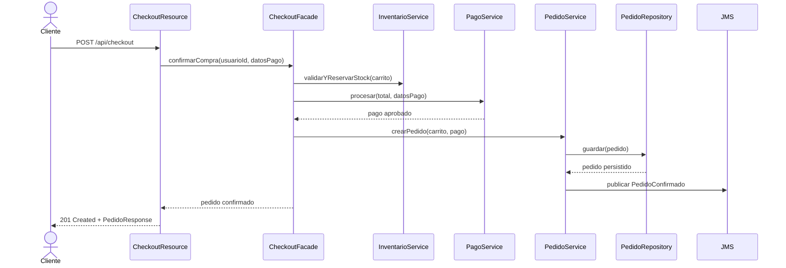

# Mockup del TP Integrador — E-commerce

> Documento guía inicial. Define cómo debería verse, organizarse y demostrarse el TP según las clases 1, 2 y 3 de Desarrollo de Aplicaciones II.

## 1. Idea general

El proyecto será una tienda online donde un cliente pueda registrarse, consultar productos, administrar un carrito y confirmar una compra. El objetivo académico no es competir con una plataforma comercial, sino demostrar con claridad:

- programación orientada a componentes;
- arquitectura de tres capas;
- contratos e inyección de dependencias;
- patrones de diseño aplicados con una justificación real;
- persistencia con JPA;
- integración sincrónica y asincrónica;
- servicios web REST y, si la consigna posterior lo exige, SOAP;
- documentación técnica, demo funcional y defensa oral.

## 2. Alcance recomendado

### Funcionalidades obligatorias del MVP

1. Registro e inicio de sesión de clientes.
2. Listado y búsqueda de productos por nombre o categoría.
3. Consulta del detalle, precio y stock de un producto.
4. Alta, modificación y eliminación de ítems del carrito.
5. Cálculo del subtotal y total.
6. Confirmación de una compra con validación de stock.
7. Simulación de un pago aprobado o rechazado.
8. Creación y consulta de pedidos.
9. Notificación asincrónica al confirmar el pedido.
10. Administración básica de productos y stock.

### Fuera del alcance inicial

- pagos reales;
- logística o tracking conectado a empresas reales;
- facturación fiscal;
- promociones complejas;
- múltiples vendedores;
- microservicios independientes;
- infraestructura cloud.

Estas exclusiones mantienen el foco en los objetivos de la materia y evitan sobre-ingeniería.

## 3. Actores y casos de uso

### Cliente

- registrarse e iniciar sesión;
- explorar el catálogo;
- agregar o quitar productos del carrito;
- confirmar la compra;
- consultar sus pedidos.

### Administrador

- crear y editar productos;
- activar o desactivar productos;
- actualizar stock;
- consultar pedidos realizados.

## 4. Mockup visual de pantallas

### Catálogo

```text
┌────────────────────────────────────────────────────────────────────┐
│ TPO Store          [ Buscar productos... ]     Carrito (2)  Usuario│
├───────────────┬────────────────────────────────────────────────────┤
│ Categorías    │ CATÁLOGO                                           │
│ ○ Todas       │ ┌────────────┐ ┌────────────┐ ┌────────────┐       │
│ ○ Tecnología  │ │  Imagen    │ │  Imagen    │ │  Imagen    │       │
│ ○ Hogar       │ │ Producto A │ │ Producto B │ │ Producto C │       │
│ ○ Deportes    │ │ $ 25.000   │ │ $ 18.500   │ │ $ 41.000   │       │
│               │ │ Stock: 8   │ │ Stock: 3   │ │ Sin stock  │       │
│               │ │ [Agregar]  │ │ [Agregar]  │ │ [Ver]      │       │
│               │ └────────────┘ └────────────┘ └────────────┘       │
└───────────────┴────────────────────────────────────────────────────┘
```

### Carrito y checkout

```text
┌────────────────────────────────────────────────────────────────────┐
│ CARRITO                                                            │
├─────────────────────────────────────────────┬──────────────────────┤
│ Producto A    $25.000    [-] 1 [+] [Quitar] │ Resumen              │
│ Producto B    $18.500    [-] 2 [+] [Quitar] │ Subtotal: $62.000    │
│                                             │ Envío:     $3.000    │
│                                             │ TOTAL:    $65.000    │
│                                             │ [Confirmar compra]   │
└─────────────────────────────────────────────┴──────────────────────┘
```

### Administración

```text
┌────────────────────────────────────────────────────────────────────┐
│ ADMINISTRACIÓN                                                     │
├────────────────────────────────────────────────────────────────────┤
│ [Nuevo producto]  [Productos]  [Pedidos]                           │
│ SKU       Nombre        Precio       Stock       Estado   Acciones │
│ TEC-001   Auriculares   $25.000      8           Activo   Editar   │
│ HOG-004   Lámpara       $18.500      3           Activo   Editar   │
└────────────────────────────────────────────────────────────────────┘
```

## 5. Arquitectura general

Las capas serán lógicas y se desplegarán juntas dentro de un único archivo WAR, como recomienda la clase para un TP de este tamaño.



### Reglas de dependencia

- Presentación solo conoce contratos de negocio y DTOs.
- Un controller recibe la petición, valida el formato y delega; no decide reglas comerciales.
- Los services concentran reglas y orquestación.
- Todo acceso persistente pasa por repositories/DAO.
- Los repositories no toman decisiones de negocio.
- Ninguna vista consulta directamente la base de datos.
- Las implementaciones externas se consumen mediante interfaces y adapters.

## 6. Componentes funcionales

| Componente | Responsabilidad | Interfaces principales | Dependencias |
|---|---|---|---|
| Usuario | Registro, autenticación y perfiles | `UsuarioService`, `AutenticacionService` | UsuarioRepository |
| Catálogo | Productos, categorías y búsqueda | `CatalogoService` | ProductoRepository, CategoriaRepository |
| Inventario | Consulta, reserva y descuento de stock | `InventarioService` | ProductoRepository |
| Carrito | Ítems, cantidades y cálculo del total | `CarritoService` | Catálogo, Inventario |
| Pedido | Creación, estados e historial | `PedidoService` | Carrito, Inventario, PedidoRepository |
| Pago | Procesamiento simulado del pago | `PagoService`, `PasarelaPago` | Adapter de pago |
| Checkout | Orquestación completa de la compra | `CheckoutFacade` | Carrito, Inventario, Pedido, Pago |
| Notificación | Avisos por eventos del sistema | `NotificacionService` | JMS / listener |

Un componente no equivale a una pantalla. Cada componente encapsula una capacidad de negocio y puede contener clases de distintas capas.

## 7. Organización del código

Se recomienda organizar primero por componente y, dentro de cada componente, separar sus capas. Esto mantiene juntas las piezas relacionadas sin perder la arquitectura Controller → Service → Repository.

```text
TPO/
├── README.md
├── MOCKUP_TPO.md
├── pom.xml
├── docs/
│   ├── arquitectura/
│   ├── diagramas/
│   ├── entregas/
│   └── defensa/
├── src/
│   ├── main/
│   │   ├── java/ar/edu/desarrolloappii/ecommerce/
│   │   │   ├── config/
│   │   │   ├── shared/
│   │   │   │   ├── exception/
│   │   │   │   └── dto/
│   │   │   ├── usuario/
│   │   │   │   ├── controller/
│   │   │   │   ├── service/
│   │   │   │   ├── repository/
│   │   │   │   └── domain/
│   │   │   ├── catalogo/
│   │   │   ├── inventario/
│   │   │   ├── carrito/
│   │   │   ├── pedido/
│   │   │   ├── pago/
│   │   │   ├── checkout/
│   │   │   └── notificacion/
│   │   ├── resources/
│   │   │   └── META-INF/persistence.xml
│   │   └── webapp/
│   │       ├── assets/
│   │       ├── index.html
│   │       └── WEB-INF/beans.xml
│   └── test/java/ar/edu/desarrolloappii/ecommerce/
└── .vscode/
    ├── extensions.json
    └── tasks.json
```

## 8. Patrones que deben verse en el código

| Patrón / rol | Aplicación concreta | Justificación |
|---|---|---|
| Controller | `ProductoResource`, `CarritoResource`, `PedidoResource` | Traduce HTTP a casos de uso sin contener lógica de negocio |
| Service Layer | `CarritoService`, `PedidoService` | Centraliza reglas y procesos del dominio |
| Repository / DAO | `ProductoRepository`, `PedidoRepository` | Aísla JPA y la base de datos del negocio |
| DTO | `ProductoResponse`, `AgregarItemRequest` | Evita exponer entidades JPA en la API |
| Facade | `CheckoutFacade` | Ofrece una operación simple para un proceso que coordina varios componentes |
| Adapter | `PasarelaPagoSimuladaAdapter` | Permite reemplazar el proveedor de pagos sin modificar checkout |
| Factory | `NotificadorFactory` | Selecciona una implementación de notificación sin acoplar al consumidor |
| Observer / Pub-Sub | Evento `PedidoConfirmado` vía JMS | Desacopla la compra del envío de notificaciones |

No se agregarán patrones sin una necesidad concreta. Cada patrón usado deberá aparecer en el diagrama y explicarse durante la defensa.

## 9. Modelo de dominio inicial



## 10. Caso de uso principal: confirmar compra

Este recorrido sirve para cumplir la rúbrica de mostrar un caso de uso atravesando las tres capas.



### Reglas de negocio demostrables

- no se puede agregar una cantidad menor que uno;
- no se puede superar el stock disponible;
- el total se recalcula en el servidor, nunca se confía en el enviado por el cliente;
- un pedido solo se confirma si el pago fue aprobado;
- si falla una operación crítica, la transacción revierte;
- la notificación no bloquea la confirmación del pedido.

## 11. API propuesta

| Método | Ruta | Responsabilidad |
|---|---|---|
| POST | `/api/usuarios` | Registrar cliente |
| POST | `/api/auth/login` | Iniciar sesión |
| GET | `/api/productos` | Buscar/listar productos |
| GET | `/api/productos/{id}` | Consultar detalle |
| POST | `/api/carritos/{id}/items` | Agregar producto |
| PATCH | `/api/carritos/{id}/items/{itemId}` | Cambiar cantidad |
| DELETE | `/api/carritos/{id}/items/{itemId}` | Quitar producto |
| GET | `/api/carritos/{id}` | Consultar carrito y total |
| POST | `/api/checkout` | Confirmar compra |
| GET | `/api/pedidos/{id}` | Consultar pedido |
| GET | `/api/usuarios/{id}/pedidos` | Consultar historial |
| POST | `/api/admin/productos` | Crear producto |
| PATCH | `/api/admin/productos/{id}/stock` | Actualizar stock |

## 12. Stack recomendado

- **IDE:** Visual Studio Code.
- **Lenguaje:** Java 17 o superior.
- **Build:** Maven.
- **Plataforma:** Jakarta EE con namespace `jakarta.*`.
- **Servidor:** WildFly, por ser el servidor de referencia de la comisión.
- **Presentación:** HTML/CSS/JavaScript y recursos JAX-RS; puede adaptarse a JSP/JSF si el docente lo solicita.
- **Negocio:** CDI + EJB (`@Inject`, `@Stateless`, transacciones declarativas).
- **Datos:** JPA/Hibernate y base de datos relacional.
- **Integración asincrónica:** JMS y Message-Driven Bean.
- **Empaquetado:** WAR.
- **Pruebas:** unitarias para services y de integración para repositories/API.

## 13. Evolución por entregas

### TP inicial y checkpoint 1 — Unidades I y II

- dominio y alcance;
- actores y casos de uso;
- componentes e interfaces;
- diagrama de presentación, negocio y datos;
- stack elegido;
- proyecto Maven desplegable en WildFly;
- recorrido de “agregar al carrito” o “confirmar compra”.

### Entrega obligatoria 1 — Unidades I, II y III

- capas implementadas;
- catálogo, carrito y pedido básicos;
- persistencia JPA;
- patrones DAO/Repository, Service, Facade y Factory o Adapter;
- pruebas iniciales;
- documentación y demo.

### Checkpoint y entrega obligatoria 2 — Unidades IV, V y VI

- integración entre componentes;
- acceso local/remoto según la consigna;
- evento JMS de pedido confirmado;
- cola o tópico y consumidor asincrónico;
- servicios REST y eventual servicio SOAP;
- pruebas de los flujos integrados;
- documentación y demo.

### Entrega final

- Unidades I a VI integradas;
- flujo completo de compra estable;
- código, diagramas y documentación consistentes;
- instrucciones reproducibles de build y despliegue;
- guion de defensa de 20–25 minutos;
- demo con escenario exitoso y al menos un error controlado.

## 14. Guion sugerido para la defensa

1. Problema y alcance del e-commerce.
2. Actores y caso de uso principal.
3. Componentes y contratos.
4. Arquitectura de tres capas.
5. Recorrido Controller → Service → Repository.
6. Patrones elegidos y por qué existen.
7. Persistencia y transacciones.
8. Integración JMS y servicios web.
9. Demo de compra.
10. Pruebas, decisiones y mejoras futuras.

## 15. Checklist de calidad

- [ ] Las tres capas están claramente identificadas.
- [ ] Cada clase tiene una responsabilidad comprensible.
- [ ] Los controllers son delgados.
- [ ] Los services contienen las reglas de negocio.
- [ ] Toda persistencia pasa por repositories.
- [ ] Las dependencias se inyectan y se programan contra interfaces.
- [ ] Las entidades JPA no se exponen directamente en la API.
- [ ] Los patrones están justificados y documentados.
- [ ] Hay al menos un caso de uso diagramado de punta a punta.
- [ ] Las credenciales y URLs no están hardcodeadas.
- [ ] `mvn clean package` genera un WAR desplegable.
- [ ] La documentación permite ejecutar el proyecto desde cero.
- [ ] La demo incluye un flujo exitoso y errores de negocio controlados.

## 16. Errores que debemos evitar

- confundir una pantalla con un componente;
- escribir lógica de negocio en controllers;
- acceder a JPA o SQL desde la presentación;
- crear un único `EcommerceService` que haga todo;
- inventar microservicios innecesarios para un TP pequeño;
- depender directamente de una pasarela de pago concreta;
- usar patrones solo para mencionarlos;
- cambiar de stack a mitad del proyecto;
- dejar diagramas desactualizados respecto del código.

---

Este mockup es la línea base. Las consignas posteriores del docente pueden ampliar o ajustar el alcance, pero no deberían romper la separación por capas ni los contratos entre componentes.
