# Guion de la defensa — Entrega Obligatoria N.º 1

> **GOMARKET** · Comisión Lunes TM · 2.º Cuatrimestre 2026
> Duración: ~14 min de exposición + preguntas (la consigna da 20-25 min por grupo)

**Integrantes y bloques:** Rodrigo (apertura + estructura y capas) ·
Fol (Catálogo) · Ivan (Carrito) · Tomás (Usuario y seguridad) ·
Nicolás (cierre: pruebas y ciclo de vida).

> Si el grupo del TP son cuatro y no cinco, el cierre de **Nicolás** lo absorbe
> Rodrigo: es el único bloque que no depende de los anteriores.

---

## PARTE 0 · Preparación (hacerlo ANTES de entrar al aula)

### Checklist de 5 minutos

Hay un script que levanta todo y te imprime el checklist:

```bash
cd ~/Materias/DesarrolloAppII/TPO

./scripts/demo.sh          # front + navegador (2 segundos)
./scripts/demo.sh --tests  # …y corre los 84 tests
./scripts/demo.sh --todo   # …y reconstruye el WAR y levanta WildFly
```

**El día de la presentación usá `--todo`**: recompila el WAR (así el servidor no
sirve el front viejo), lo despliega y arranca WildFly dejando el log a la vista.

Busca el proceso **por puerto**, no por nombre: un `pkill -f 'http.server 4321'`
puede matarte la propia terminal, porque el patrón matchea tu propio comando.

<!-- Si preferís a mano, o si el script falla: -->

```bash
# 1 · Servidor estático del front — acá corre la demo
cd ~/Materias/DesarrolloAppII/TPO/src/main/webapp
python3 -m http.server 4321
#    → http://localhost:4321
```

```bash
# 2 · Tests, en otra terminal
cd ~/Materias/DesarrolloAppII/TPO
node --test 'src/test/js/**/*.test.mjs'
#    → 84 pass, 0 fail
```

```bash
# 3 · WildFly, en una tercera terminal (ver PARTE 1)
cd ~/Materias/DesarrolloAppII/wildfly/wildfly-41-ee10
./bin/standalone.sh
```

**Ventanas abiertas, en este orden:**

| # | Qué | Para qué |
|---|---|---|
| 1 | Navegador en `localhost:4321` | la demo |
| 2 | DevTools abierto (F12), pestaña **Consola** | el 403 en vivo |
| 3 | Editor con `componentes/` y `java/…/catalogo/` lado a lado | la estructura |
| 4 | Terminal con los tests | el cierre |
| 5 | Terminal con el log de WildFly | el ciclo de vida |

**Antes de arrancar, en la consola del navegador:**

```js
localStorage.clear(); location.reload();
```

Así arrancás sin sesión y con el carrito vacío. **Si no hacés esto, la demo del
401 no funciona** porque quedás logueado de la prueba anterior.

### 🖥️ Qué hay en el proyector, y cuándo

**Primero lo básico: son TRES pantallas distintas y no hay que mezclarlas.**

| Pantalla | Qué muestra | Quién la usa |
|---|---|---|
| **Navegador** — `localhost:4321` | la app andando | Fol, Ivan, Tomás |
| **Editor / terminal** | las carpetas y los archivos | Rodrigo, y el cierre de cada bloque |
| **Consola de DevTools** (F12 → pestaña **Console**) | el `AccesoDenegadoError` | Tomás, **una sola vez** |

> Cuando el guion dice *"abrir tal archivo"* se refiere al **editor**, nunca al
> navegador. Y cuando Tomás abre DevTools va a **Console**, no a *Inspector*:
> el Inspector muestra el HTML de la página y no sirve para nada de esto.

Para las carpetas lado a lado hay un script, que en una terminal a 18 pt se lee
mejor que la barra lateral de un editor:

```bash
./scripts/capas.py
```


La app andando **no alcanza**. Mirá cómo pesa la rúbrica:

| Criterio | Peso | Con qué se prueba |
|---|---|---|
| Correctitud funcional | 25 % | **la app andando** |
| Diseño arquitectónico y componentes | 25 % | **el código** |
| Patrones e integración justificados | 20 % | **el código** |

Mostrando sólo la app estás jugando por el 25 %. El otro 45 % se demuestra
abriendo archivos. **La app es la evidencia; el código es el argumento.**

| Quién | Qué hay en pantalla | Mayormente |
|---|---|---|
| **Rodrigo** | Editor con las dos carpetas, `producto-repository.js`, `compartido/` | **CÓDIGO** |
| **Fol** | App (búsquedas, orden, facetas) → `catalogo-service.js` | App, cierra en código |
| **Ivan** | App (carrito, topes, envío) → `carrito-service.js` | App, cierra en código |
| **Tomás** | App → **consola (F12)** → `usuario-service.js` → App (panel admin) | Mitad y mitad |
| **Nicolás** | Terminal (tests) → archivos de test → terminal WildFly → `.java` → App (temas) | **TERMINAL + código** |

**Tres cosas que hunden demos:**

1. **Agrandá las fuentes ANTES de entrar.** Editor 18-20 pt, terminal 16-18 pt.
   Y ojo: **la consola de DevTools tiene su tamaño aparte** — y es justo el
   momento más importante de Tomás, cuando sale el `AccesoDenegadoError`.
2. **Cambiá de ventana, hacé una pausa, y después hablá.** Nunca al mismo
   tiempo: si cambiás mientras hablás, nadie leyó lo que mostraste.
3. **Cerrá notificaciones, WhatsApp y pestañas de más.**

---

### 📋 Datos reales del catálogo — memorizá estos, no inventes

El catálogo tiene **16 productos activos en 5 categorías**. Estos son los que
usa la demo, verificados contra `assets/data/catalogo.json`:

| Para mostrar | Producto | Dato |
|---|---|---|
| Búsqueda sin acentos | escribir `cafe` | → **Cafetera de Filtro Signature** |
| "Todas las palabras" (da 1) | escribir `teclado mecanico` | → **Teclado Mecánico Compacto** |
| "Todas las palabras" (da 0) | escribir `teclado cafetera` | → **sin resultados** ← el remate |
| **Tope de stock** | **Escritorio Regulable en Altura** | **stock 2** · $874.500 · categoría oficina |
| Envío gratis (cruzar $150.000) | **Botella Térmica 750 ml** | $38.900 · stock 34 · **4 unidades = $155.600** |
| Producto agotado | Parlante Portátil Cobre · Smartwatch Deportivo GPS | stock 0 |

> ⚠️ **No digas "mouse inalámbrico".** No hay ningún mouse en el catálogo: la
> búsqueda te va a devolver cero y se te cae la demo. Ese ejemplo estaba mal en
> la documentación vieja.

---

## PARTE 1 · WildFly: cómo levantarlo y qué mostrar

### ⚠️ Primero, el problema que hay que resolver

El WAR que está desplegado es del **4 de septiembre** — tiene el front **viejo**,
de antes de reestructurar en componentes. Si durante la demo alguien abre
`localhost:8080/ecommerce/`, va a ver una versión que no coincide con lo que
están contando.

**Opción A — recomendada: reconstruir el WAR** (un minuto, y queda todo coherente)

```bash
cd ~/Materias/DesarrolloAppII/TPO
export JAVA_HOME=/usr/lib/jvm/java-17-openjdk-amd64
./mvnw clean package                    # → target/ecommerce.war

WF=~/Materias/DesarrolloAppII/wildfly/wildfly-41-ee10
cp target/ecommerce.war "$WF/standalone/deployments/"
```

**Opción B — sin recompilar:** no abrir `localhost:8080/ecommerce/` en ningún
momento. WildFly se usa **sólo para el log**. Funciona, pero si el docente pide
ver la app en el servidor, quedás incómodo.

> Hagan la A. Es un minuto y les saca un riesgo de encima.

### Levantar el servidor

```bash
cd ~/Materias/DesarrolloAppII/wildfly/wildfly-41-ee10
./bin/standalone.sh
```

Esperar hasta ver `WFLYSRV0025: WildFly ... started in XXXXms`.

### Qué mostrar exactamente — son 3 cosas, 30 segundos

**1 · La línea del `@PostConstruct` en el log del arranque**

Buscar en la terminal (o filtrar):

```bash
rg 'Catálogo cargado|Deployed' ~/Materias/DesarrolloAppII/wildfly/wildfly-41-ee10/standalone/log/server.log | tail -5
```

Tiene que aparecer:

```
INFO  [org.jboss.as.server] WFLYSRV0010: Deployed "ecommerce.war"
INFO  [org.jboss.as] WFLYSRV0025: WildFly 41.0.0.Final started
INFO  [ar.edu.desarrolloappii...CatalogoEnMemoria] (default task-2)
      Catálogo cargado: 16 productos, 5 categorías        <- con la 1.ª petición
```

**Esa línea la imprimió el contenedor, no nosotros.** Nadie llamó a `cargar()`:
lo llamó WildFly al crear el bean. Eso es la evidencia del ciclo de vida
gestionado que pide la consigna.

> **(!) La línea NO aparece sola al arrancar WildFly.** `CatalogoEnMemoria` es
> `@ApplicationScoped`, y ese scope es **perezoso**: el contenedor crea el bean —y
> corre el `@PostConstruct`— recién cuando alguien lo usa por primera vez. **Antes de
> mostrar el log hay que tocar la API una vez:**
>
> ```bash
> curl -s http://localhost:8080/ecommerce/api/salud
> ```
>
> Medido: WildFly arrancó a las 07:27:16 y la línea salió a las 07:27:41, con la primera
> petición. Si te preguntan por qué aparece recién ahí, **es una respuesta que suma**: es
> la diferencia entre un scope perezoso y uno ansioso, y muestra que entendiste cuándo
> instancia el contenedor.


**2 · Las dos anotaciones, en el editor**

```java
// CatalogoEnMemoria.java:31 y 52
@ApplicationScoped                         // ← una instancia por despliegue
public class CatalogoEnMemoria implements ProductoRepository, CategoriaRepository {

    @PostConstruct                         // ← callback de inicialización
    void cargar() { ... }
```

```java
// CatalogoServiceImpl.java:34
@Stateless                                 // ← pool de instancias del contenedor
public class CatalogoServiceImpl implements CatalogoService {
```

**3 · La API respondiendo** (opcional, 10 segundos)

```bash
curl http://localhost:8080/ecommerce/api/salud
curl 'http://localhost:8080/ecommerce/api/productos?q=cafe'
```

### Por qué esto importa tanto

La consigna pide, textual:

> *"Al menos 1 componente stateful y 1 stateless, con **evidencia de que el
> contenedor gestiona su ciclo de vida** (uso de anotaciones o callbacks de
> inicialización / destrucción)."*

Un frontend **no tiene contenedor**. Ese requisito no se puede cumplir con JS
suelto en un navegador, y es el único punto de la entrega donde "presentamos
solo el front" se queda corto.

Pero el componente Catálogo **ya está desplegado en WildFly**, con `@Stateless`,
`@ApplicationScoped` y `@PostConstruct` funcionando. Mostrarlo son 30 segundos y
tapa el agujero.

> **"Presentamos solo el frontend" no significa "escondé el backend que ya
> tenés andando."**

---

# EL GUION

> Una pasada, en el orden en que se presenta. Cada uno tiene su bloque con todo
> lo que necesita: lo que prepara, con qué frase entra, **lo que dice**, sus
> capturas y las preguntas que le pueden hacer.
>
> Las acotaciones entre `[corchetes]` son acciones: no se dicen en voz alta.

---

## 🎙️ RODRIGO — Apertura, estructura y capas · 5 min

**Abrís vos.** No hay nadie antes.
**Preparás:** el editor con estas dos carpetas lado a lado:

- `src/main/webapp/assets/js/componentes/`
- `src/main/java/ar/edu/desarrolloappii/ecommerce/catalogo/`

Y estas cuatro pestañas, que se muestran **de a pares en pantalla dividida**:

| Capa | Panel izquierdo (JS) | Panel derecho (Java) |
|---|---|---|
| **datos** | `producto-repository.js` · línea **46** | `ProductoRepository.java` · línea **18** |
| **negocio** | `catalogo-service-local.js` · línea **81** | `CatalogoServiceImpl.java` · línea **52** |

> Para el negocio va `catalogo-service-local.js`, **no** `catalogo-service.js`. Ese
> último es la fachada y la factory —no tiene ni una regla de dominio adentro— y además
> es el que abre Fol en su bloque.

**Entrás cuando:** No hay nadie antes. Arrancás con el proyector ya en el editor.

### Lo que decís

Buenas. Nosotros somos el grupo de **GOMARKET**, un e-commerce. Hoy les traemos
la primera entrega obligatoria y vamos a mostrar **el cliente**: tres
componentes completos, cada uno con su arquitectura en capas.

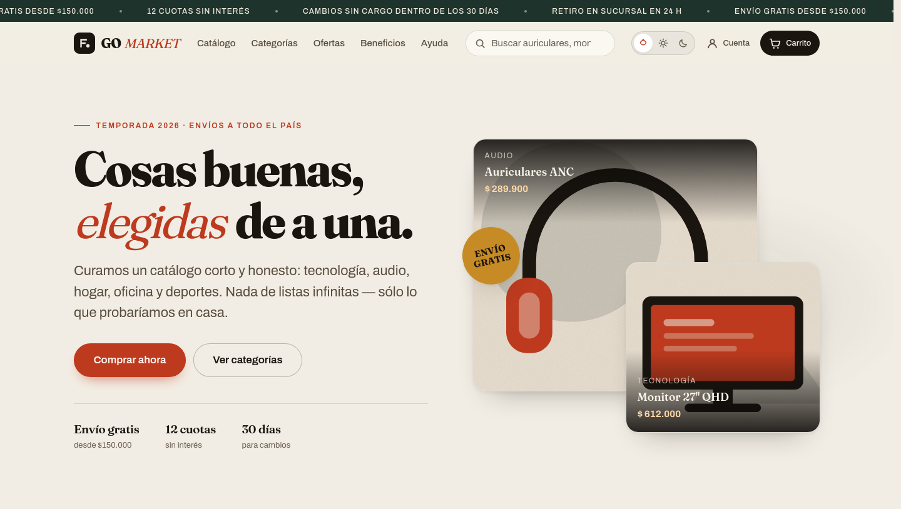


Antes de abrir nada quiero decir la idea que ordena todo lo que sigue, porque si
se entiende esto el resto se sigue solo:

> **Un componente no es una pantalla.**

En la clase tres, cuando nos devolvió el TP inicial, usted dijo que algunos
grupos estaban mezclando esas dos cosas. Nosotros éramos uno de esos grupos.
Teníamos una landing muy linda con un catálogo, un carrito y un checkout, y les
decíamos "componentes". No lo eran: eran tres pantallas y un archivo de
orquestación de treinta kilobytes.

Lo que hicimos fue reorganizar el cliente **por componente y, dentro de cada
componente, por capa**. Van a ver tres: **Catálogo**, **Carrito** y **Usuario** —
que son tres de los cuatro que usted mismo identificó para el caso de la tienda
online.

El orden va a ser así: yo les muestro la estructura y las capas; después Fol
toma el Catálogo, que es nuestro componente *stateless*; Ivan el Carrito, que es
el *stateful*; Tomás el componente Usuario, que es el que nos da la seguridad
declarativa; y Nicolás cierra con las pruebas y con una cosa del servidor.

Una aclaración de entrada, para que no quede colgada: dijimos que presentábamos
solo el front, pero el componente **Catálogo también está implementado en
Jakarta EE 10 sobre Java 17**, empaquetado como un WAR único y desplegado en
**WildFly 41**. Al final Nicolás lo muestra, porque hay un requisito de la
consigna que sólo se puede ver ahí.

Empiezo por la estructura, que es lo que ordena todo lo demás.

---

`[En la TERMINAL — no en el navegador — correr `./scripts/capas.py`]`

A la izquierda el **frontend**, lo que corre en el navegador. A la derecha el
**backend**, lo que corre en el servidor: Jakarta EE sobre WildFly.

```
assets/js/componentes/              src/main/java/…/ecommerce/catalogo/
├── catalogo/                       ├── controller/    ← presentación
│   ├── presentacion/               ├── service/       ← negocio
│   ├── negocio/                    ├── repository/    ← datos
│   └── datos/                      └── domain/
├── carrito/
│   ├── presentacion/
│   ├── negocio/
│   └── datos/
└── usuario/
    ├── presentacion/
    ├── negocio/
    └── datos/
```

**Es la misma forma de los dos lados del cable.** Y no es simetría decorativa:
es lo que nos permite decir con precisión qué pieza del cliente se borra cuando
su equivalente del servidor entre en producción.

Lo agrupamos así por una razón concreta, y la vivimos en esta misma entrega.

Cuando agregamos el componente **Usuario** —el del login y los roles—, **nació entero
en una sola carpeta**: su vista, su servicio y su repositorio. Lo único que tocamos
afuera fue el arranque, para cablearlo.

Si hubiéramos agrupado primero por capa, ese mismo componente quedaba **repartido en
tres ramas del árbol**, con un pedazo de Usuario en cada una. Y el día que haya que
sacarlo, hay que ir a buscar los restos a tres lugares.

**Las piezas que cambian juntas tienen que estar juntas.** Por eso: primero el
componente, después la capa.

`[Abrir producto-repository.js]`

Las reglas de comunicación entre capas que vimos en la clase tres las cumplimos
y se pueden verificar leyendo los `import`. Miren esta, que es la que más cuesta:

```js
/** Todos los productos, sin filtrar. El filtrado es decisión del negocio. */
async buscarTodos() { ... }
```

El repositorio devuelve **todo**, sin filtrar, y es **a propósito**: quién es
visible, cómo se busca y cómo se ordena son decisiones del negocio, no de la
base. Lo dejamos tonto a propósito.

Si el repositorio filtrara, estaría tomando decisiones de negocio — justo lo que
la **lámina 20** marca como no permitido: *«datos "subiendo" para tomar
decisiones de negocio»*.

`[Señalar el Java al lado]`

Y es exactamente lo que dice el `ProductoRepository` de Java, con las mismas
palabras, porque lo escribimos primero ahí.

`[Panel izquierdo: catalogo-service-local.js línea 81 · derecho: CatalogoServiceImpl.java línea 52]`

Y acá está la otra mitad: la capa de **negocio**. Fíjense cómo arranca —pidiéndole al
repositorio `buscarTodos()`—. **Recién después decide**: filtra por activo, por
categoría, por texto, por stock, por precio, y ordena.

El repositorio entrega. El negocio decide. Y es la misma cadena en los dos lenguajes:

```
JavaScript                                    Java
const todos = await productos.buscarTodos()   productos.buscarTodos().stream()
  .filter(p => p.activo)                        .filter(Producto::isActivo)
  .filter(p => cumpleCategoria(p, criterios))   .filter(p -> cumpleCategoria(p, criterios))
  .filter(p => cumpleTexto(p, criterios))       .filter(p -> cumpleTexto(p, criterios))
  .filter(p => cumpleStock(p, criterios))       .filter(p -> cumpleStock(p, criterios))
  .filter(p => cumplePrecio(p, criterios))      .filter(p -> cumplePrecio(p, criterios))
  .sort(ESTRATEGIAS_DE_ORDEN[criterios.orden])  .sorted(comparador(criterios.orden()))
```

Y una aclaración, para que se entienda qué estoy mostrando: **esto es la explicación
técnica**. Están viendo el contrato y las reglas, no la app corriendo. En un minuto Fol
les muestra en la demo **cómo se ejecuta todo esto** contra el catálogo real.

`[Abrir compartido/]`

Una última cosa: esta carpeta, `compartido`, **no es un componente**. Son
servicios técnicos transversales — el transporte HTTP, el acceso a
`localStorage`, el manejo del foco en los modales. El equivalente de lo que el
contenedor le provee al backend sin que ninguno lo implemente.

Fol sigue con el Catálogo.

---

### Te pueden preguntar a vos

| Pregunta | Respuesta |
|---|---|
| *¿Dónde está la capa de datos del front?* | En `componentes/<x>/datos/`. Son DAOs sobre `localStorage` y sobre el JSON semilla. |
| *¿`compartido` no rompe la separación?* | No: no tiene reglas de negocio de ningún componente. Es infraestructura — transporte HTTP, foco, formato. |
| *¿Qué pasa si un componente necesita a otro?* | Se inyecta desde `main.js` como función. Por ejemplo el carrito recibe `alExigirSesion`; no importa el módulo de Usuario. |
| *¿No es mucha carpeta para tan poco código?* | Es el costo de la separación, y la consigna lo pide explícito. El beneficio se cobra en los tests: el negocio se prueba sin navegador. |
| *¿Por qué no usaron un framework?* | Módulos ES nativos ya dan separación real de responsabilidades y el despliegue es copiar archivos. La complejidad se agrega cuando duele, no antes. |

---

## 🎙️ FOL — CatálogoComponent, stateless · 3 min

**Preparás:** navegador en `localhost:4321`, scrolleado al catálogo.
Tené `catalogo-service.js` abierto en una pestaña del editor.

**Entrás cuando:** Rodrigo cierra con: *"Fol sigue con el Catálogo."*

### Lo que decís

`[Navegador en localhost:4321]`

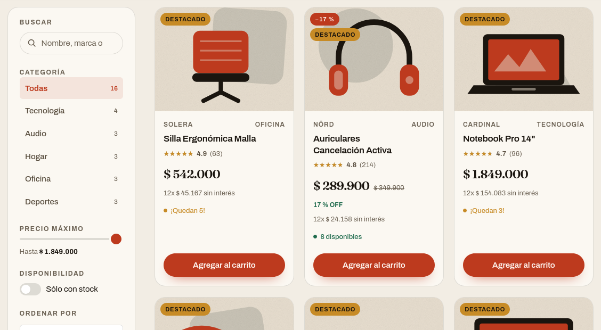


El componente Catálogo. Su responsabilidad es mostrar productos, categorías y
stock, y buscar, filtrar y ordenar.

`[Abrir las tres carpetas de componentes/catalogo/ en el editor]`

Antes de mostrarles qué hace, quiero que vean **qué es**. Mi componente son
estas tres carpetas:

- `presentacion/catalogo-view.js` — **dibuja**
- `negocio/catalogo-service.js` — **decide**
- `datos/producto-repository.js` — **entrega filas**
- `datos/categoria-repository.js` — ídem, para las categorías

Presentación, negocio y datos. Las tres capas, adentro de un solo componente.

`[Escribir "cafe" en el buscador]`


Escribo `cafe`, sin acento, y encuentra la **Cafetera de Filtro**. La búsqueda
normaliza los acentos y las mayúsculas.

`[Escribir "teclado mecanico"]`

Acá busco con dos palabras y encuentra el **Teclado Mecánico Compacto**. Hasta
ahí nada raro. Pero miren esto:

`[Escribir "teclado cafetera"]`


**Cero resultados.** Si esto fuera un `LIKE` con un `OR`, me tendría que haber
devuelto los dos productos. Devuelve nada, porque la regla es que **todas** las
palabras del término tienen que estar en el mismo producto.

`[Cambiar el orden a "menor precio", después a "mejor puntaje"]`

Los ordenamientos son cinco y son intercambiables en tiempo de ejecución. Eso es
un **Strategy**: cada orden es un comparador en un mapa, elegido por su clave.
Agregar un orden nuevo es agregar una entrada; no se toca el método `buscar()` ni
hay un `switch` que crece para siempre.

`[Señalar los conteos de las categorías]`

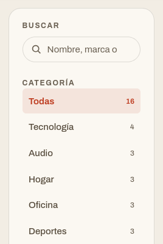


Y estos números de al lado de cada categoría son **facetas**: se calculan sobre
el catálogo vivo con los filtros actuales, ignorando el filtro de categoría.

Ahora, lo importante del componente: **es *stateless***. No guarda nada entre
llamadas. Dos búsquedas iguales dan el mismo resultado sin importar el orden ni
quién las pidió. Por eso del lado del servidor se declara `@Stateless` y el
contenedor puede tener un pool de instancias: cualquiera atiende a cualquiera.

`[Abrir catalogo-service.js]`

Y acá hay una decisión que quiero explicar porque puede parecer rara. El
contrato `CatalogoService` tiene **dos implementaciones**:

```js
hay backend  → CatalogoServiceRemoto   (Adapter: delega al Jakarta EE)
no hay       → CatalogoServiceLocal    (reglas propias + repositorio en memoria)
```

Y una **Factory** elige una sola, al arrancar, preguntándole a `GET api/salud`.

¿Por qué? Porque la tienda se publica en dos destinos: el WAR en WildFly y un
sitio estático. Cuando hay backend, el componente Catálogo **ya está
implementado en Java**, con su negocio y sus datos. El cliente no lo duplica:
usa un **Adapter** que traduce los criterios de búsqueda a query params y el DTO
de vuelta a dominio, y delega.

Si alguien piensa "están duplicando las reglas": no. Es **una especificación con
dos implementaciones**, y sólo una está activa. La local existe porque el
despliegue estático no tiene servidor a quién preguntarle. Es el caso de capas
lógicas contra capas físicas de la clase tres: las tres capas siguen existiendo,
sólo que dos corren en otra máquina.

Sigue Ivan con el Carrito, que es el contraste.

---

> **Tené esto a mano**, por si te piden ver una ficha de producto:

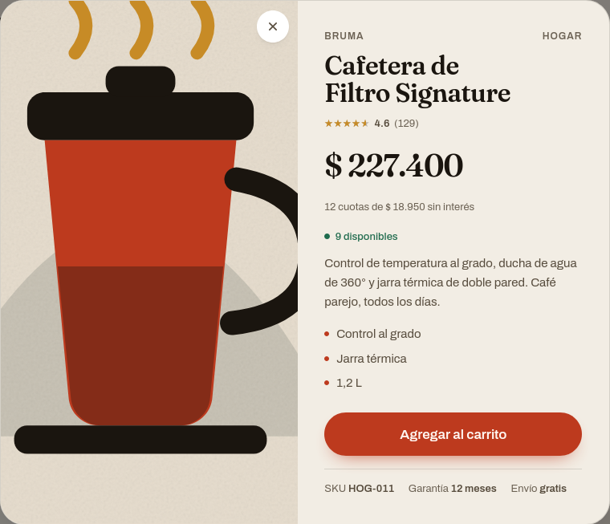


### Te pueden preguntar a vos

| Pregunta | Respuesta |
|---|---|
| *¿No estás duplicando la lógica de negocio?* | **La pregunta que más probable te hagan.** Dos implementaciones del mismo contrato; la fábrica elige UNA al arrancar. La local existe porque el despliegue estático no tiene backend. |
| *¿Cómo decide la fábrica?* | Consulta `GET api/salud` una sola vez. En WildFly responde `SaludResource`; en el estático, un rewrite devuelve `disponible: false`. |
| *¿Por qué no mirar el hostname?* | Porque se rompe apenas cambia el dominio. Y provocar un 404 a propósito ensucia la consola con errores de red. |
| *¿Por qué Adapter y no un fetch y listo?* | Un fetch en la vista filtra HTTP a la presentación: tendría que saber de códigos de estado, y la misma UI no andaría en el estático. |
| *Mostrame el Strategy* | `ESTRATEGIAS_DE_ORDEN` en `catalogo-service-local.js`. Es el mismo mapa de `Comparator` que arma `comparador(Orden)` en Java. |

---

## 🎙️ IVAN — CarritoComponent, stateful · 3 min

**Preparás:** el carrito vacío. Tené `carrito-service.js` abierto.
**Tus dos productos, verificados en el catálogo:**
- **Escritorio Regulable en Altura** — **stock 2** (para el tope)
- **Botella Térmica 750 ml** — $38.900, stock 34 (para el envío gratis)

**Entrás cuando:** Fol cierra con: *"Sigue Ivan con el Carrito, que es el contraste."*

### Lo que decís

`[Buscar "escritorio regulable" → Escritorio Regulable en Altura, stock 2]`

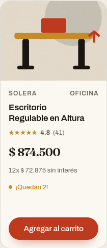


El componente Carrito. Fol les mostró el stateless; este es el **stateful**, y
quiero que quede clara la diferencia, porque no es "guarda cosas en algún lado".

`[Abrir las tres carpetas de componentes/carrito/ en el editor]`

Antes de mostrarles qué hace, quiero que vean **qué es**. Mi componente son
estas tres carpetas:

- `presentacion/carrito-view.js` — **dibuja**
- `negocio/carrito-service.js` — **decide**
- `datos/carrito-repository.js` — **entrega filas**

Presentación, negocio y datos. Las tres capas, adentro de un solo componente.

Agarro este escritorio, que tiene **stock dos**. Lo dice la ficha.

`[Clic en Agregar al carrito]`

Agrego uno. Miren el botón: ahora dice **"Agregar otra (1)"**.

`[Clic otra vez]`

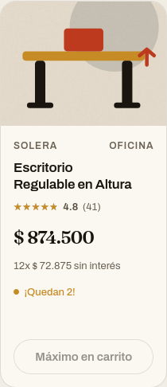


Dos. Y ahora el botón dice **"Máximo en carrito"** y quedó deshabilitado, porque
este producto tiene stock dos y ya me los llevé los dos.

Hice **la misma acción dos veces**, sobre el mismo producto, y la tercera vez el
sistema me dice que no. El resultado de la operación **depende de todo lo que
hice antes**. Eso es estado conversacional, y eso es ser *stateful*.

El Catálogo, llamado tres veces igual, contesta tres veces lo mismo. El Carrito
no. Por eso del lado del servidor este componente se declara `@Stateful` y el
contenedor garantiza que cada cliente hable siempre con **su** instancia.

`[Abrir el panel del carrito]`

Otra decisión: **el total nunca se persiste**. Se recalcula desde los ítems cada
vez que se pide el resumen.

`[Cambiar una cantidad con los botones + y −]`

Miren cómo el subtotal, el envío y el total siguen al cambio. Si guardáramos el
total, estaríamos guardando una verdad que puede vencer: cambia un precio, cambia
una cantidad, y el total mentiría. Es la misma razón por la que el backend
recalcula el total en el checkout y no confía en el que le manda el cliente.

`[Vaciar el carrito. Buscar "botella" → Botella Térmica 750 ml, $38.900]`

Vacío y agarro algo barato para mostrar otra regla. Esta botella sale treinta y
ocho mil novecientos.

`[Agregar, y tocar + hasta llegar a 4 unidades]`

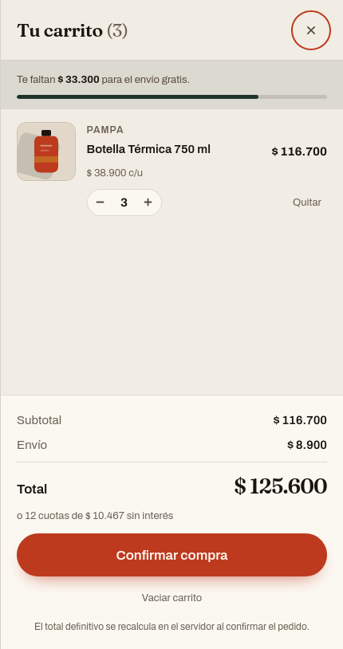


Miren la barra de arriba: me va diciendo cuánto me falta para el envío gratis. Y
en la cuarta unidad cruzo los ciento cincuenta mil…

`[Se libera]`

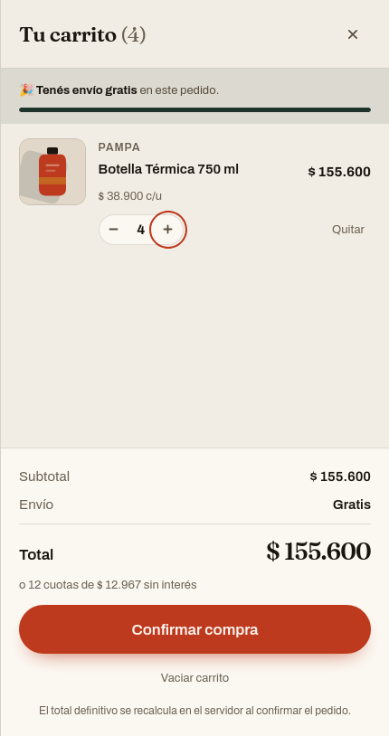


…y el envío pasa a **Gratis**. Es otra regla de negocio, y vive en el servicio,
no en la vista. La vista sólo dibuja lo que el negocio le contesta.

`[Abrir carrito-service.js]`

Dos cosas de diseño, rápido. Primero, el **DAO**: este servicio no toca
`localStorage`. Le habla a un `CarritoRepositoryLocal` a través de un contrato.
Cuando exista `POST /api/carritos/{id}`, agregamos un `CarritoRepositoryRest` que
cumple el mismo contrato y **este archivo no se toca**.

Segundo, el **Observer**:

```js
alCambiar(fn) { ... }
```

La insignia de la cabecera, el panel lateral y los botones de la grilla se
actualizan solos. El negocio emite y sigue; **no conoce la vista**. Por eso este
archivo no importa una sola línea de DOM. Si el negocio llamara a las funciones
de dibujo, la dependencia quedaría invertida y las capas se romperían.

Tomás sigue con Usuario, que es donde aparece la seguridad.

---

### Te pueden preguntar a vos

| Pregunta | Respuesta |
|---|---|
| *¿Por qué el carrito es stateful y el catálogo no?* | Porque `agregar()` depende de la historia previa del cliente y `buscar()` no depende de nada. Hay un test de cada cosa. |
| *¿Dónde persiste el carrito?* | `localStorage`, vía `CarritoRepositoryLocal`. El servicio no lo sabe: habla con el contrato. |
| *Si el usuario edita el `localStorage`, ¿qué pasa?* | El repositorio sanea la forma al leer y el servicio recorta la cantidad al stock. Y de todos modos el servidor va a revalidar: el cliente es cómodo, no es autoridad. |
| *¿Por qué devuelve `{ok:false, motivo}` en vez de lanzar?* | Porque llegar al tope de stock no es un error del sistema, es una respuesta legítima del negocio, y la vista la avisa con otro tono. |
| *¿El total lo calcula el front?* | Lo calcula para mostrarlo. El que vale es el que recalcula el backend en el checkout. |

---

## 🎙️ TOMÁS — UsuarioComponent y seguridad declarativa · 3 min

**Preparás:** DevTools abierto en Consola. **El carrito con algo adentro** (te lo
deja cargado Ivan) y **sin sesión iniciada**.
Tené `usuario-service.js` abierto.

> ⚠️ Si quedaste logueado de una prueba, corré `localStorage.clear()` antes.
> Si no, el 401 no se ve.

**Entrás cuando:** Ivan cierra con: *"Tomás sigue con Usuario, que es donde aparece la seguridad."*

### Lo que decís

El tercer componente es **Usuario**: registro, autenticación, sesión y
autorización por rol. Es el que nos permite cumplir el requisito de seguridad
declarativa de la consigna.

`[Abrir las tres carpetas de componentes/usuario/ en el editor]`

Antes de mostrarles qué hace, quiero que vean **qué es**. Mi componente son
estas tres carpetas:

- `presentacion/usuario-view.js` — **dibuja**
- `negocio/usuario-service.js` — **decide**
- `datos/usuario-repository.js` — **entrega filas**

Presentación, negocio y datos. Las tres capas, adentro de un solo componente.

`[Con el carrito cargado, clic en Confirmar compra]`

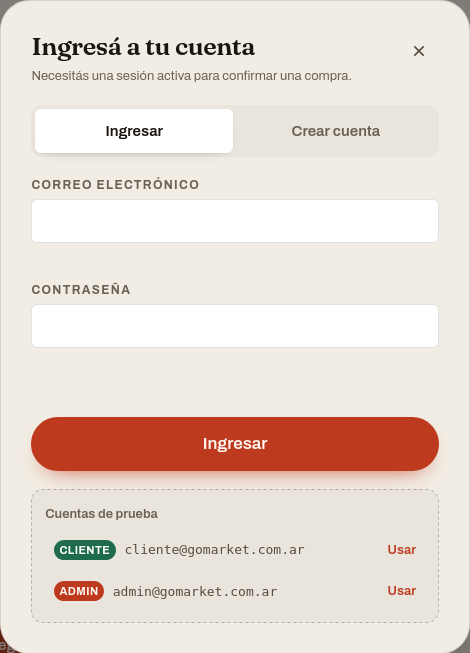


Miren: intento confirmar la compra sin haber iniciado sesión, y el sistema **no
me deja** y me abre el formulario. Eso, del lado del negocio, es un **401: no sé
quién sos**.

`[Ingresar como cliente@gomarket.com.ar / cliente123 — hay un botón que carga los datos]`

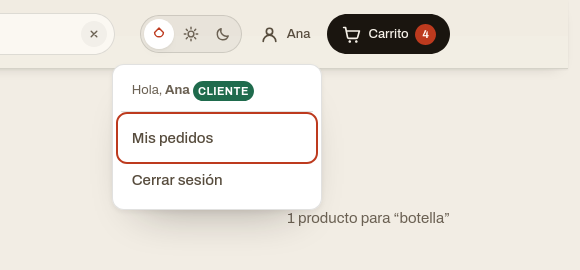


Entro como cliente. Fíjense en el menú de cuenta: aparece mi nombre y el chip de
rol **CLIENTE**. Y fíjense en lo que **no** aparece: no hay panel de
administración, porque este rol no lo tiene.

Ahora, alguien podría decir "bueno, ocultaste el botón". Vamos a la consola.

`[F12 → Consola]`

```js
gomarket.usuario.listarUsuarios()
```

`[Ejecutar → sale AccesoDenegadoError]`

**`AccesoDenegadoError`.** Un 403. No es que escondimos el botón: la operación
está protegida, y salta igual aunque la llame desde la consola salteándome toda
la interfaz.

`[Abrir usuario-service.js]`

Así está declarada:

```js
export const listarUsuarios = autorizar([ROLES.ADMIN], () => { ... });
```

Y esto de acá es lo que estábamos buscando reproducir:

```java
@RolesAllowed({"ADMIN"})
public List<Usuario> listarUsuarios() { ... }
```

En Jakarta EE uno no escribe un `if` adentro del método: **anota**, y el
contenedor intercepta antes de que el cuerpo corra. Nuestro `autorizar()` hace
lo mismo, aplicado en el momento de declarar la operación.

¿Qué se gana contra un `if` desperdigado? Tres cosas. La regla **se lee en la
firma**, no enterrada en el cuerpo. Vale para **todas** las invocaciones, no para
la rama que uno se acordó de proteger. Y la operación de negocio queda **limpia**
de código de seguridad.

Cuando esto pase al backend, borramos `autorizar([...])` y ponemos
`@RolesAllowed`. **Cambia el ejecutor, no el diseño.**

`[Salir, ingresar como admin@gomarket.com.ar / admin123]`

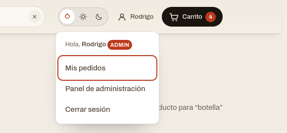


Entro como administrador. Ahora sí aparece el panel.

`[Abrir el panel de administración]`

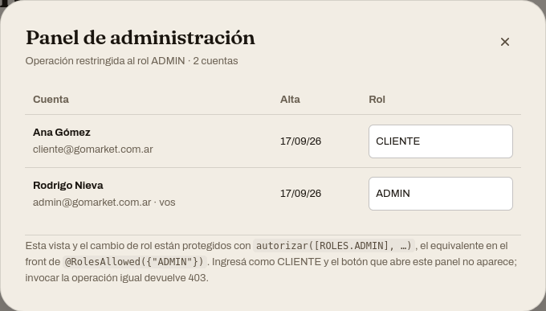


Acá está el padrón de cuentas, y puedo cambiar un rol.

`[Intentar cambiarse a sí mismo a CLIENTE]`

Y si intento degradarme a mí mismo, no me deja: quedaría el sistema sin nadie que
pueda administrarlo.

Dos aclaraciones que preferimos hacer nosotros antes de que nos las pregunten.

**La primera, las contraseñas.** No guardamos texto en claro: guardamos hash
SHA-256 con un salt por usuario, así que dos personas con la misma contraseña dan
hashes distintos. Ahora, **SHA-256 no es lo correcto para contraseñas** — lo
correcto es bcrypt o Argon2, que son deliberadamente lentos. En el navegador no
hay forma honesta de hacer eso, y cuando el registro pase a `POST /api/usuarios`
el hash lo va a calcular el backend con Argon2. Lo que sí se sostiene es que la
contraseña nunca se persiste en claro.

**La segunda, y es la más importante: un front nunca es una frontera de
seguridad.** Cualquiera abre el devtools y se escribe `rol: ADMIN` en el
`localStorage`. Eso no es un descuido nuestro, es la naturaleza del cliente. Lo
que estamos demostrando acá es el **diseño** de la autorización: dónde se
declara, cómo se propaga, qué error produce. La autoridad real vive en el
servidor, que revalida todo. Es la misma lógica del carrito, que calcula totales
para que el usuario vea algo, pero el total que vale es el que recalcula el
backend.

Una última cosa de arquitectura. `confirmarCompra()` está declarada en el
**Carrito**, no acá:

```js
// carrito-service.js
export const confirmarCompra = autorizar([ROLES.CLIENTE, ROLES.ADMIN], ...);
```

El componente dueño de la operación declara su propia regla, usando la primitiva
que expone Usuario. Carrito no sabe cómo se verifica una contraseña; Usuario no
sabe qué es un ítem. **La seguridad es un servicio transversal**, igual que en el
contenedor.

Cierra Nicolás.

---

> **Tené esto a mano**, por si preguntan cómo se crea una cuenta:

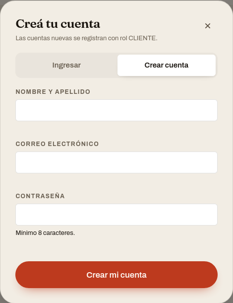


### Te pueden preguntar a vos

| Pregunta | Respuesta |
|---|---|
| *Esto no es seguridad de verdad* | **Dale la razón y seguí.** No lo es, y es a propósito. Un front no es frontera de seguridad. Demostramos el diseño; la autoridad la tiene el servidor. |
| *¿Por qué SHA-256 y no bcrypt?* | Porque bcrypt tiene sentido en el servidor. Acá lo que se sostiene es que la contraseña no se guarda en claro. |
| *¿Qué diferencia hay entre 401 y 403?* | 401 es "no sé quién sos", 403 es "sé quién sos y no te alcanza". Son dos errores distintos porque son dos problemas distintos. |
| *¿Por qué `autorizar` y no un `if`?* | El `if` hay que acordarse de ponerlo en cada rama. `autorizar` envuelve la operación al declararla: vale para todas las invocaciones. |
| *¿El rol se puede falsificar?* | Sí, desde el cliente. Por eso el backend va a revalidar. Nosotros mostramos dónde se declara la regla, no dónde se hace cumplir en producción. |
| *¿Por qué `confirmarCompra` está en Carrito?* | Porque el componente dueño de la operación declara su propia regla, usando la primitiva de Usuario. Igual que `@RolesAllowed` la pone el componente y la hace cumplir el contenedor. |

---

## 🎙️ NICOLÁS — Cierre: pruebas y ciclo de vida · 3 min

**Cerrás vos.** Después de tu bloque vienen las preguntas.
**Preparás:** la terminal de los tests y la de WildFly ya levantada (te las deja
listas Rodrigo), más `catalogo-service-local.test.mjs`,
`carrito-service.test.mjs`, `CatalogoEnMemoria.java` y `CatalogoServiceImpl.java`
abiertos en el editor.

**Entrás cuando:** Tomás cierra con: *"Cierra Nicolás."*

### Lo que decís

`[Terminal 2 — apretás Enter]`

Antes de terminar les quiero mostrar dos cosas. La primera son los tests.

`[Corren, tardan menos de un segundo]`

**Ochenta y cuatro pruebas, todas pasan.** Pero lo importante no es el número: es
**cómo** corren. Fíjense que no abrí el navegador, no hay internet de por medio, y no
instalamos ninguna librería. Es Node y nada más.

`[Abrir catalogo-service-local.test.mjs]`

Y esto es lo que lo hace posible. Miren estas tres líneas:

```js
servicio = new CatalogoServiceLocal(
  new ProductoRepositoryFalso(CATALOGO),
  new CategoriaRepositoryFalso(CATEGORIAS)
);
```

Al servicio le pasamos **repositorios de mentira**, inventados ahí mismo para la prueba.
Y funciona igual, porque **el servicio no sabe de dónde vienen los datos**: sólo sabe
que alguien se los va a dar.

Por eso lo podemos probar sin navegador, sin base de datos y sin la API. Y por eso
también decimos que las capas están separadas de verdad: **si estuvieran todas
mezcladas, este archivo directamente no andaría.**

`[Abrir carrito-service.test.mjs]`

Y acá está el test que prueba lo que contó Ivan, el tema del estado:

```js
carrito.agregar(producto)  →  ok
carrito.agregar(producto)  →  ok
carrito.agregar(producto)  →  RECHAZADO
```

Tres veces exactamente lo mismo, y la tercera dice que no. Porque el carrito se acuerda
de las dos anteriores. Eso es lo que hace que sea *stateful*.

Una cosa más: los tests del catálogo son **los mismos casos** que los del backend en
Java. Si alguna de las dos versiones se desviara, el test lo avisa.

`[Terminal 3 — WildFly]`

Y lo segundo es el servidor.

Vamos acá porque hay una cosa que **no se puede mostrar desde el navegador**. La
consigna pide demostrar que el contenedor —el servidor— es el que maneja los
componentes: el que los crea, los usa y los destruye. Y en el navegador no hay
contenedor, así que eso no lo podemos probar con JavaScript.

Pero el componente Catálogo también lo tenemos hecho en Java, y está corriendo acá.
Miren esta línea del log:

```
Catálogo cargado: 16 productos, 5 categorías
```

`[Abrir CatalogoEnMemoria.java]`

Esa línea la escribe este método de acá. Y lo importante es esto: **nosotros nunca lo
llamamos.** No hay ni una línea en nuestro código que diga "ejecutá esto". Lo único que
hicimos fue ponerle una etiqueta arriba:

```java
@PostConstruct
void cargar() { ... }
```

Esa etiqueta le dice al servidor *"cuando crees este objeto, ejecutá esto"*. Y el
servidor lo hizo solo. **Eso es el contenedor manejando el ciclo de vida.**

`[Abrir CatalogoServiceImpl.java]`

Y acá hay otra etiqueta parecida, `@Stateless`, que le avisa al servidor que este
componente no guarda estado — así puede reutilizar la misma instancia para atender a
cualquiera.

> **(!) La línea NO aparece sola al arrancar WildFly.** `CatalogoEnMemoria` es
> `@ApplicationScoped`, y ese scope es **perezoso**: el contenedor crea el bean —y
> corre el `@PostConstruct`— recién cuando alguien lo usa por primera vez. **Antes de
> mostrar el log hay que tocar la API una vez:**
>
> ```bash
> curl -s http://localhost:8080/ecommerce/api/salud
> ```
>
> Medido: WildFly arrancó a las 07:27:16 y la línea salió a las 07:27:41, con la primera
> petición. Si te preguntan por qué aparece recién ahí, **es una respuesta que suma**: es
> la diferencia entre un scope perezoso y uno ansioso, y muestra que entendiste cuándo
> instancia el contenedor.
`[Tocar el selector de temas de la cabecera]`

Y dos cositas más que el Anexo marca como puntos extra y están hechas. Los tres temas se
cambian en el momento, no son capturas de cada variante.

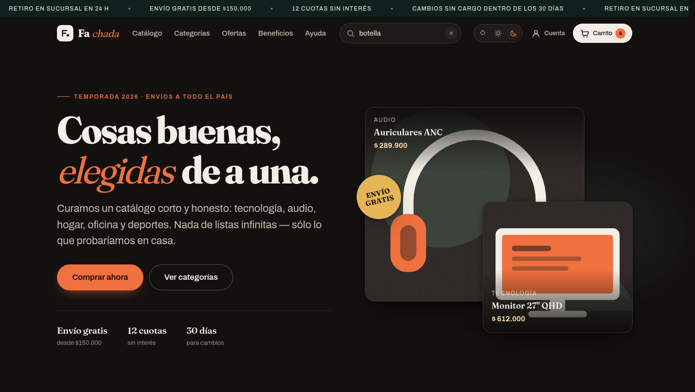

`[Angostar la ventana, o abrirlo en el celular]`

Y es responsive de 320 a 1440 px: la misma interfaz, sin una segunda versión para móvil.

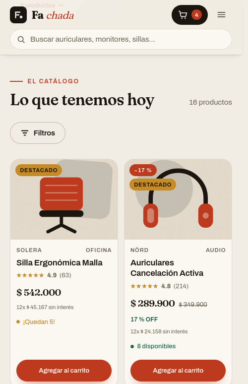

Eso es todo. Quedamos para las preguntas.

### Te pueden preguntar a vos

| Pregunta | Respuesta |
|---|---|
| *¿84 tests de qué?* | 25 del catálogo, 28 del carrito, 31 de usuario. Reglas de negocio, no interfaz. |
| *¿Y las pruebas de interfaz?* | No están automatizadas todavía, lo verificamos a mano. Automatizarlas con Playwright está en el roadmap. **(No inventes un número.)** |
| *¿Por qué el catálogo no necesita el navegador para probarse?* | Porque no depende de él: recibe sus repositorios por constructor. Le pasamos unos falsos y anda igual. |
| *¿Qué hace exactamente `@PostConstruct`?* | Le dice al servidor que ejecute ese método apenas crea el objeto, antes de que nadie lo use. Acá carga el catálogo una sola vez. |
| *¿Por qué la línea aparece recién con la primera petición?* | Porque `@ApplicationScoped` es perezoso: el servidor crea el objeto cuando alguien lo necesita, no al desplegar. |
| *¿Por qué `@ApplicationScoped` y no `@Stateless` en el repositorio?* | Porque queremos una sola instancia por despliegue, para leer el catálogo una vez. `@Stateless` daría varias y cada una lo leería de nuevo. |
| *¿Tienen `@PreDestroy`?* | Todavía no: hoy no hay nada que liberar al apagar. Cuando entre la base de datos va a hacer falta. |

---

## El stack, dicho bien — para los cinco

Cualquiera puede recibir esta pregunta, así que los cinco tienen que poder
contestarla igual.

| | |
|---|---|
| **Java** | 17 |
| **Jakarta EE** | **10.0.0** |
| **Servidor** | **WildFly 41.0.0.Final**, perfil EE 10 Full Platform |
| **Empaquetado** | WAR único (`ecommerce.war`) |
| **Namespace** | 30 imports, todos `jakarta.*`, cero `javax.*` |

Y estos tres errores delatan que no se entendió el concepto:

| ❌ No digas | ✅ Decí |
|---|---|
| *"Usamos Jakarta"* (como si fuera un servidor) | *"Jakarta EE es la especificación; WildFly la implementa"* |
| *"WildFly es el framework"* | *"WildFly es el **servidor de aplicaciones**"* |
| *"El servidor gestiona los componentes"* | *"El **contenedor** gestiona los componentes; el servidor aloja los contenedores"* |

El último es fino pero cuenta: la Clase 2 separa **servidor de aplicaciones**
(aloja contenedores, expone HTTP, RMI, JMS) de **contenedor** (web y EJB —
gestiona ciclo de vida, inyección, transacciones y seguridad). Cuando Nicolás
dice *"nadie llamó a `cargar()`, lo llamó WildFly"*, en rigor lo llamó **el
contenedor CDI** que WildFly aloja. Dicho así, mejor.

---

## Reglas para los cinco

1. **Si no sabés, decí "no lo sé, lo pensamos para la próxima entrega".** La
   rúbrica premia comprensión, no improvisación. Inventar es lo único que hunde.
2. **Nunca digas un número que no podés mostrar.** Ni de tests, ni de
   componentes, ni de cobertura.
3. **Cualquiera puede recibir cualquier pregunta** — la consigna lo dice: *"preguntas
   individuales a cualquier integrante sobre cualquier parte del diseño"*. Léanse
   las cinco hojas, no sólo la propia.
4. **Cada uno maneja el teclado en SU bloque.** Si el docente ve que uno solo
   tiene el teclado y los demás recitan al costado, eso pesa en "comprensión
   individual" — que es el 15 % y es donde reparte notas distintas dentro del
   mismo grupo.
5. **Las tres frases que tienen que salir sí o sí:**
   - *"Un componente no es una pantalla."*
   - *"La misma llamada da distinto resultado según la historia previa: eso es stateful."*
   - *"Cambia el ejecutor, no el diseño."*
6. **Si algo falla en vivo**, no lo pelees: pasá al código y contá qué debería
   pasar. Tenés los tests para respaldarlo.
