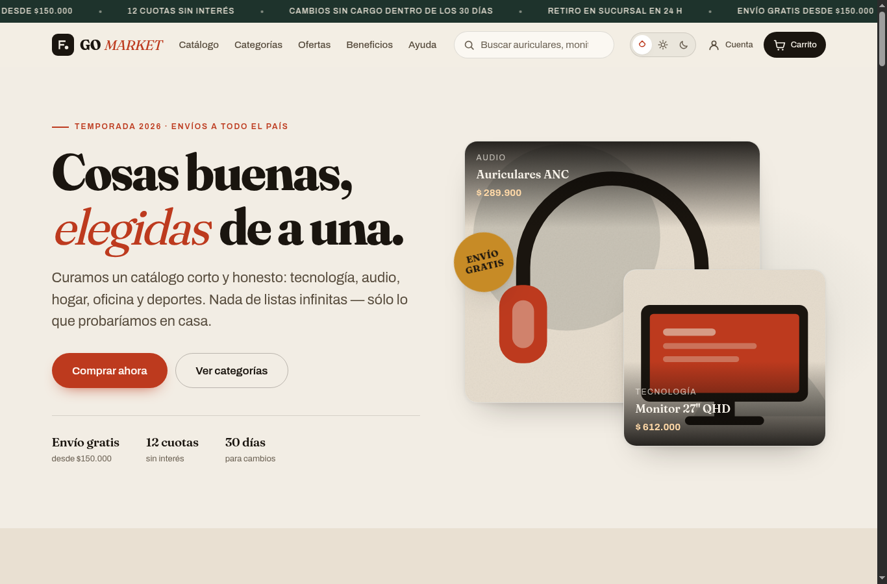
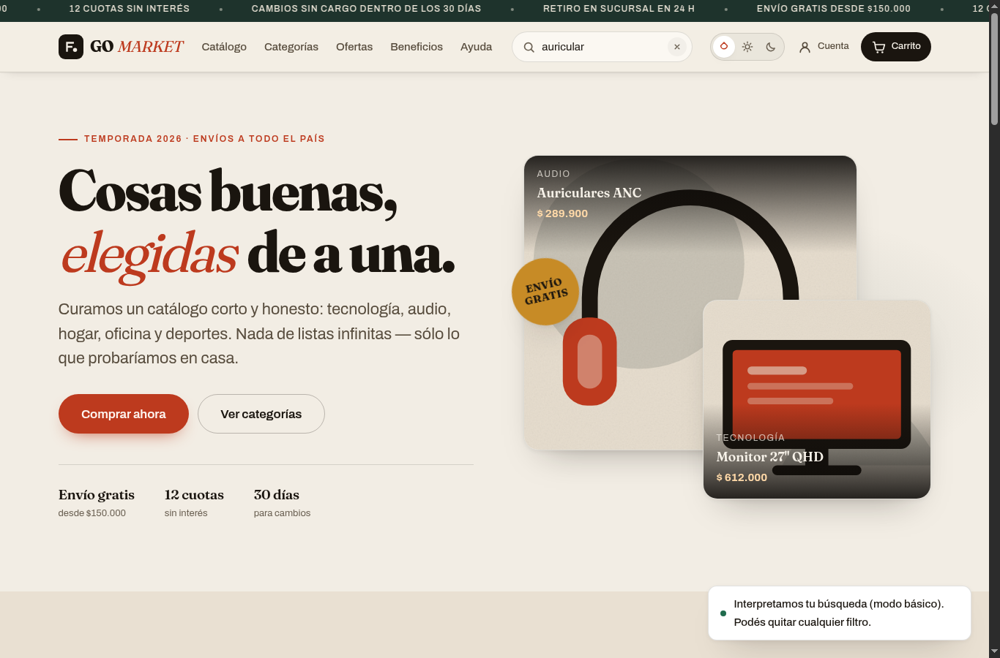
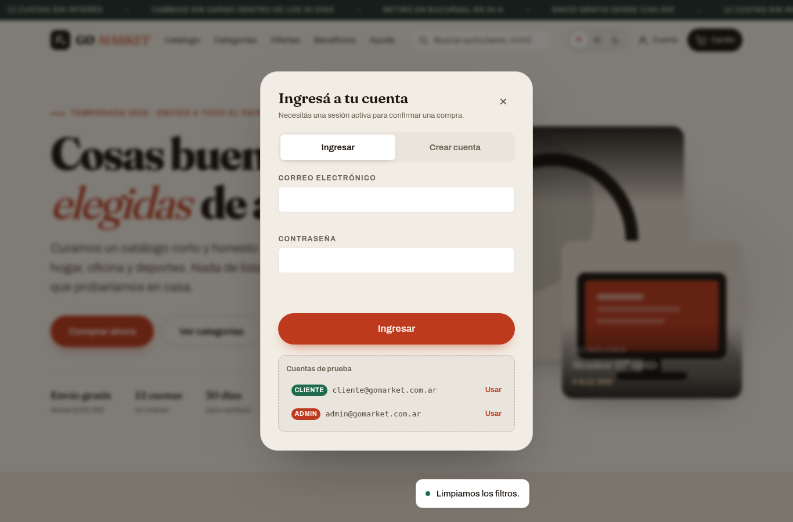
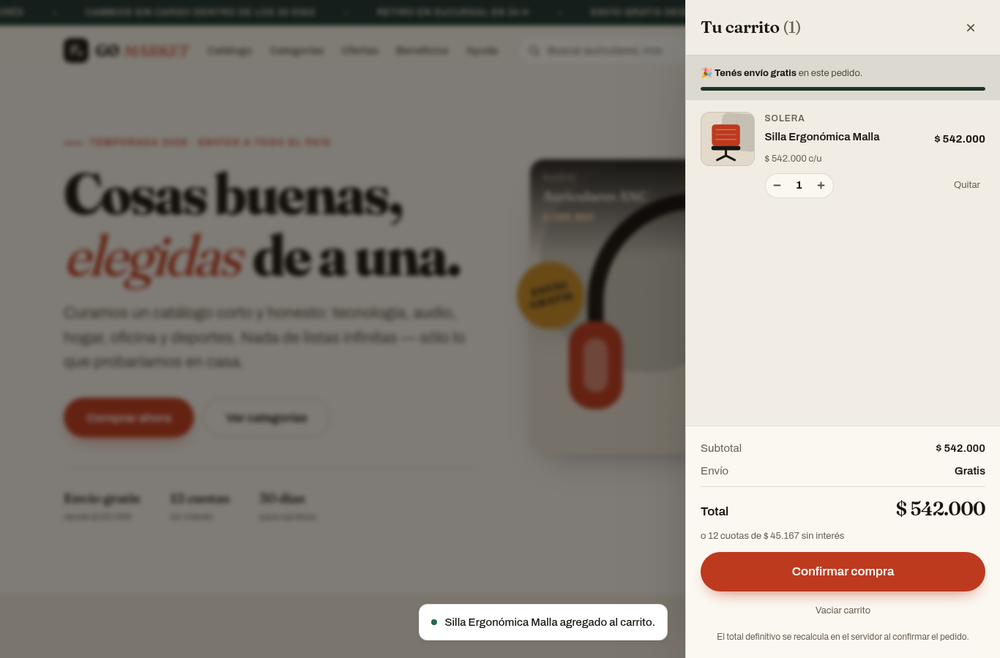
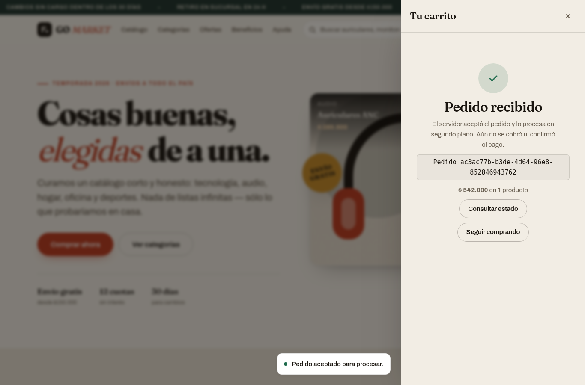
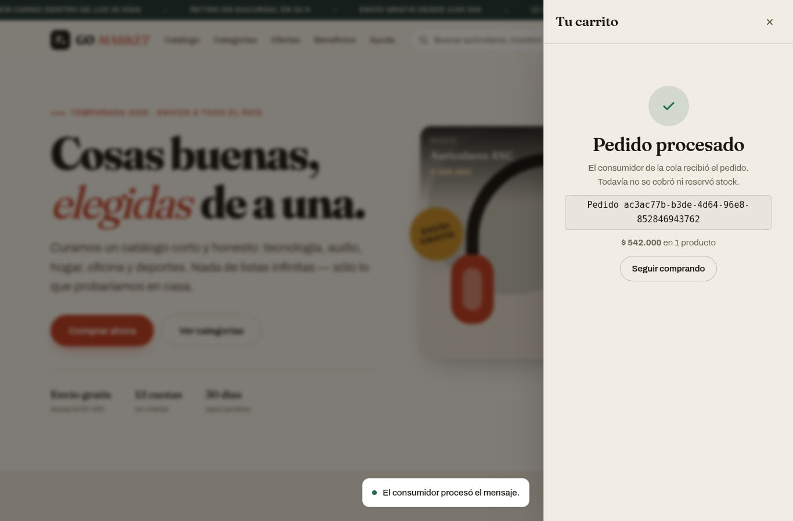

# GOMARKET · Manual de usuario (v2, 3.er checkpoint — 20/11/2026)

Grupo 5 · Desarrollo de Aplicaciones II. Público: clientes y administradores de la tienda. Estructura según ISO/IEC/IEEE 26514 y el marco Diátaxis: **tutorial** (aprender), **guías** (resolver una tarea), **referencia** (consultar) y **explicación** (entender).

GOMARKET es una tienda online de tecnología, audio, hogar, oficina y deportes. Este manual explica cómo usarla como **cliente** y como **administrador**, y al final cómo ponerla en marcha.

> Es una tienda de demostración: los pedidos no generan cobros reales.

---

## 1. Primeros pasos

Abrí **http://localhost:8080/ecommerce/** (con el servidor levantado) o la versión publicada en <https://landing-ecommerce-tau.vercel.app>. En la versión publicada no hay servidor: el catálogo funciona y las compras se simulan en el navegador, con un aviso que lo indica.

**Cuentas de prueba**

| Rol | Email | Contraseña |
|---|---|---|
| Cliente | `cliente@gomarket.com.ar` | `cliente123` |
| Administrador | `admin@gomarket.com.ar` | `admin123` |

**Temas.** Arriba a la derecha podés elegir entre 3 temas visuales. La tienda recuerda tu elección.

---

## Tutorial · Tu primera compra en 5 minutos

Las capturas son de la tienda real corriendo en WildFly (19/11/2026).

**1. Abrí la tienda.** Vas a ver el catálogo con los productos destacados.



**2. Buscá como hablás.** Escribí *auriculares baratos hasta 300 mil* en el buscador y apretá Enter. La tienda arma los filtros sola: categoría Audio, más baratos primero y precio máximo $300.000. Cada filtro es una ficha que podés quitar.



**3. Ingresá.** Menú *Cuenta* › *Ingresar*, con `cliente@gomarket.com.ar` / `cliente123`.



**4. Agregá un producto y abrí el carrito.** Revisá cantidades, envío y total.



**5. Confirmá la compra.** Vas a ver *Pedido recibido* con su código.



**6. Consultá el estado.** Tocá *Consultar estado*: el pedido ya está *procesado*.



---

# Guías prácticas

## 2. Buscar productos

### 2.1 Búsqueda común

Escribí en el buscador de la cabecera. Los resultados se actualizan mientras escribís.

- No importan los acentos ni las mayúsculas: `cafe` encuentra *Cafetera*.
- Si escribís varias palabras, se muestran los productos que tienen **todas**.
- **Esc** borra la búsqueda.

### 2.2 Búsqueda con IA (lenguaje natural)

Escribí lo que buscás como se lo dirías a un vendedor y apretá **Enter**:

> *auriculares baratos hasta 300 mil*
> *los mejor valorados de deportes en stock*
> *silla de oficina hasta $120.000*

La tienda interpreta la frase y aplica los filtros (categoría, orden, precio máximo, sólo con stock). Arriba del listado vas a ver cada filtro como una **ficha**: tocá la ✕ de una ficha para quitarlo.

- El aviso "Interpretamos tu búsqueda con IA" indica que respondió el modelo de IA. Si dice "(modo básico)", la IA no estaba disponible o tardó más de 5 segundos y se usaron reglas simples: los resultados igual son útiles.
- No escribas datos personales (emails, números de tarjeta) ni precios en otra moneda: la tienda te va a pedir que reformules.
- La búsqueda con IA se activa con frases de 3 palabras o más y sólo cuando la tienda está conectada al servidor.

### 2.3 Filtros y orden

En el panel de filtros podés:

- Elegir una **categoría** (también desde las tarjetas de categorías de la portada).
- Marcar **Sólo con stock**.
- Mover el control de **precio máximo**.
- **Ordenar** por relevancia, precio (menor o mayor), mejor puntuados o nombre.

Al lado de cada categoría se ve cuántos productos hay. **Limpiar filtros** vuelve todo al estado inicial.

### 2.4 Detalle de un producto

Tocá un producto para ver su descripción, precio, cuotas, stock disponible y puntaje.

---

## 3. Carrito y compra

1. Tocá **Agregar al carrito** en un producto.
2. Abrí el carrito con el ícono de la cabecera. Ahí podés:
   - subir o bajar cantidades con **+** y **−** (no deja superar el stock),
   - **quitar** un producto o **vaciar** el carrito.
3. El total incluye el envío: es **gratis desde $150.000**; si no, cuesta $8.900.
4. Tocá **Confirmar compra**. Si no ingresaste, la tienda te pide que ingreses primero.
   - Con el servidor, comprá con una cuenta que exista en él (por ejemplo, la de cliente de prueba). Una cuenta creada sólo en el navegador sirve para explorar, pero el servidor no la conoce y rechaza la compra.
5. Vas a ver el **código de pedido** y su estado:
   - **PENDIENTE**: el pedido fue aceptado y espera ser procesado.
   - **PROCESADO**: ya se procesó. Usá **Consultar estado** para actualizar.
   - **ERROR_ENVIO**: hubo un problema momentáneo; la tienda lo reintenta sola, no hace falta comprar de nuevo.

**¿Se me cortó la conexión al confirmar?** Volvé a tocar **Confirmar compra** con el mismo carrito. La tienda reconoce que es la misma compra y **no la duplica**.

El carrito se guarda en tu navegador: si cerrás la pestaña, sigue ahí.

---

## 4. Tu cuenta

- **Registrarte:** menú de cuenta → *Crear cuenta*. Toda cuenta nueva es de cliente.
- **Ingresar / salir:** menú de cuenta.
- Después de **5 intentos fallidos** la cuenta se bloquea unos minutos por seguridad.
- La sesión dura 30 minutos.
- Cada cliente ve **sólo sus propios pedidos**.

---

## 5. Administrador

Con la cuenta de administrador, además:

- **Padrón de usuarios:** menú de cuenta → *Panel de administración* (lista de cuentas registradas).
- **Confirmar pedidos** (desde la API): un pedido sólo se confirma cuando está PROCESADO. Si se manda `If-Match` y el pedido cambió mientras tanto, la API responde 412 y hay que volver a consultarlo.
- **Cancelar pedidos** de cualquier cliente (salvo los ya confirmados).
- **Mensajes con problemas (DLQ):** `GET /api/v1/admin/mensajeria/dlq` lista los mensajes que no se pudieron procesar después de 3 intentos, para revisarlos a mano.
- **Estado y apagado de la IA:** `GET /api/v1/admin/ia` muestra si está habilitada, el modelo, la versión del prompt, el estado del circuito y las métricas (consultas, fallback, latencia, tokens, costo). `PUT /api/v1/admin/ia/habilitada` con `{"habilitada": false}` la apaga sin reiniciar: la búsqueda sigue en modo básico.
- **Avisos de pedidos confirmados:** `GET /api/v1/admin/eventos` muestra qué recibieron notificaciones, auditoría y estadísticas.
- **Forzar reenvío:** `POST /api/v1/admin/mensajeria/reenviar` vuelve a enviar ya mismo los pedidos que quedaron en ERROR_ENVIO (normalmente se hace solo cada 15 segundos).

> Confirmar pedidos, cancelar y la DLQ por ahora se usan desde la API: la colección `entrega-3/GOMARKET-checkpoint3.postman_collection.json` trae todos los pasos en orden.

---

# Referencia

## 6. Mensajes que podés ver

| Mensaje | Qué significa | Qué hacer |
|---|---|---|
| "No hay más stock disponible de ese producto" | Llegaste al stock máximo | Nada: no se puede agregar más |
| "Pedido aceptado para procesar" | El pedido entró | Consultá el estado en unos segundos |
| "Pedido simulado localmente" | Estás en la versión publicada, sin servidor | Es una demo |
| "¿Podés reformular?" | La búsqueda con IA tenía datos personales u otra moneda | Escribila en pesos y sin datos personales |
| "Demasiados intentos" | Cuenta bloqueada temporalmente | Esperá los minutos indicados |
| "Hiciste muchas búsquedas con IA seguidas" | Más de 30 búsquedas con IA en un minuto | Esperá los segundos indicados o usá la búsqueda común |
| "El pedido cambió desde la última vez que lo consultaste" | Otra persona lo modificó antes | Volvé a consultarlo y repetí la acción |

---

## Estados de un pedido

| Estado | Qué significa |
|---|---|
| PENDIENTE | La tienda aceptó el pedido y lo está procesando |
| ERROR_ENVIO | Hubo un problema momentáneo; se reintenta solo, no hay que comprar de nuevo |
| PROCESADO | El pedido fue procesado y espera la confirmación |
| CONFIRMADO | Un administrador lo confirmó (se avisa a notificaciones, auditoría y estadísticas) |
| CANCELADO | Lo canceló el cliente o un administrador |

# Explicación

## ¿Cómo funciona la búsqueda con IA?

Tu frase pasa por un intermediario de la tienda (el *gateway de IA*) antes de llegar al modelo. Si contiene datos personales o un intento de manipulación, no se envía. Si el modelo tarda más de 5 segundos o no está disponible, la tienda usa reglas simples y te avisa con "modo básico". La IA sólo **sugiere** filtros: nunca compra ni cambia nada por vos.

## 7. Anexo: puesta en marcha (para el equipo y los docentes)

**Requisitos:** JDK 17+, WildFly 41 (`wildfly-41.0.1.Final`), Node 22 para los tests del front.

```bash
# Tests (sin servidor) + reporte de cobertura en target/site/jacoco/index.html
./mvnw verify
node --test src/test/js/*.test.mjs

# Levantar todo: compila, configura la mensajería (reintentos + DLQ) y arranca WildFly con JMS
./scripts/levantar-wildfly.sh

# En otra terminal: demo de resiliencia (Idempotency-Key, ETag, Problem Details, IA, DLQ)
./scripts/probar-resiliencia.sh            # agregá --broker para la prueba de kill -9
```

**Variables de entorno**

| Variable | Para qué | Si falta |
|---|---|---|
| `GOMARKET_JWT_SECRET` | Firmar los tokens (32+ caracteres) | El script usa una clave de demo |
| `ANTHROPIC_API_KEY` | Búsqueda con IA real | La búsqueda usa el modo básico (reglas) |
| `GOMARKET_IA_MODELO` | Cambiar el modelo de IA | `claude-haiku-5-5` |
