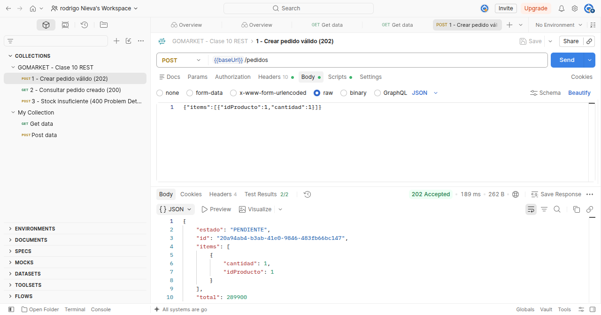
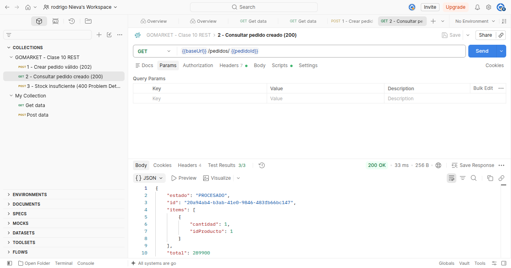
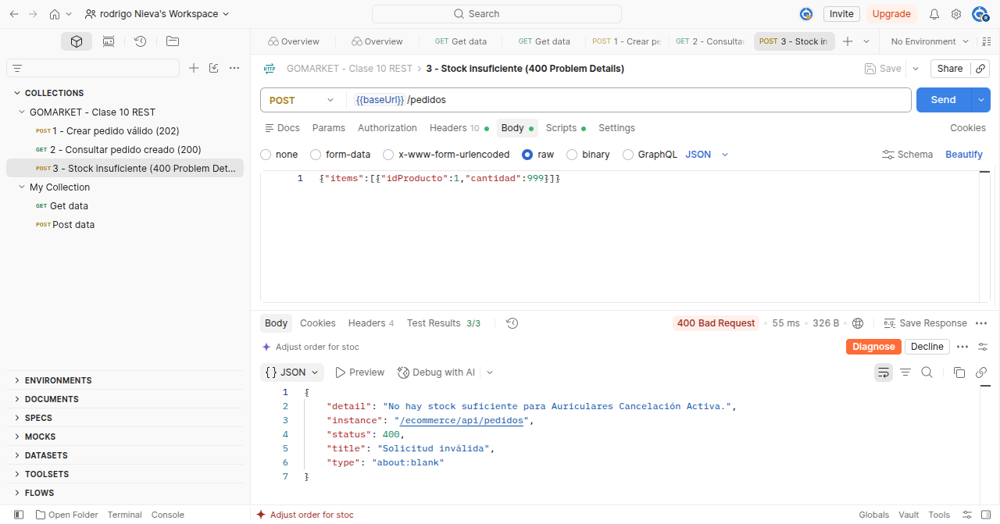
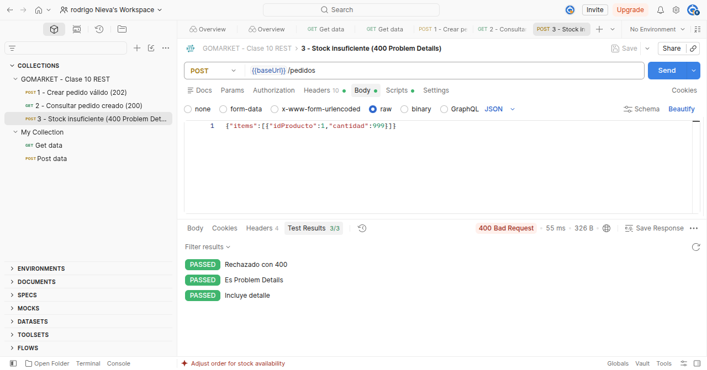

## 1. Qué se entrega y qué funciona

La actividad pide **diseñar y documentar** una API REST. Este PDF reúne el
catálogo de endpoints, ejemplos y decisiones. Se entregan por separado el
contrato `openapi.yaml`, dos ejemplos `.json` y el diagrama
`secuencia.pdf`. El código Jakarta REST desplegado es el **bonus**: se probó
en **Postman** y las capturas están en la sección 7.

**Estado real hoy:** catálogo y pedidos REST funcionando en WildFly; pedido
publicado en cola JMS y consumido por un MDB. **Sólo diseño:** ERP legado
SOAP, tópico de evento, notificador y REST externo. No hay cobro, reserva
real de stock, autenticación del servidor ni persistencia de pedidos.

## 2. Catálogo de endpoints (7 existentes; mínimo pedido: 6)

Base: `http://localhost:8080/ecommerce/api`.

1. **`GET /salud`** — Sin cuerpo de solicitud. Devuelve
   `{disponible, origen, version}`. Códigos: `200`; `5xx` si falla el servidor.
2. **`GET /categorias`** — Sin cuerpo. Devuelve una lista JSON de categorías.
   Códigos: `200`; `5xx`.
3. **`GET /productos`** — Query opcional: `q`, `categoria`, `orden`,
   `soloStock`, `precioMax`. Devuelve `{items, total}`; sin filtros hay 16
   productos. Códigos: `200`; `404` sin cuerpo si `precioMax` no es numérico;
   `5xx`. Un `soloStock` distinto de `true` se toma como `false` (`200`).
4. **`GET /productos/facetas`** — Query opcional con los filtros anteriores
   salvo `orden`. Devuelve `{total, porCategoria, precioMin, precioMax}`;
   el rango de precios es el del catálogo completo, no el filtrado.
   Códigos: `200`; `404` sin cuerpo si `precioMax` no es numérico; `5xx`.
5. **`GET /productos/{id}`** — Recibe un ID numérico en la URL. Devuelve
   nombre, SKU, precio, stock y demás datos del producto. Códigos: `200`;
   `404` Problem Details si no existe o está inactivo; `404` sin cuerpo si
   el ID no es numérico.
6. **`POST /pedidos`** — Recibe JSON (`Content-Type: application/json`),
   por ejemplo `{"items":[{"idProducto":1,"cantidad":1}]}`. El servidor
   recalcula precios y envío; el cliente no envía montos. Devuelve
   `{id, estado:"PENDIENTE", items, total}`. Códigos: `202` aceptado;
   `400` Problem Details si la lista está vacía o supera 50 ítems, hay un ID
   o cantidad inválida o repetida, no alcanza el stock o el JSON está
   malformado; `404` Problem Details si un producto no existe; `415` si el
   `Content-Type` no es JSON; `5xx` si falla el broker (el pedido queda en
   `ERROR_ENVIO`).
7. **`GET /pedidos/{id}`** — Recibe el ID UUID devuelto por el POST. Devuelve
   `{id, estado, items, total}` con estado `PENDIENTE`, `PROCESADO` o
   `ERROR_ENVIO`. Códigos: `200`; `404` Problem Details si no existe (los
   pedidos están en memoria y se pierden al reiniciar); `5xx`.

Los `5xx` son fallas posibles de infraestructura; **no se simularon como
evidencia**. El `202` no significa compra pagada. `PROCESADO` sólo indica
que el MDB recibió el mensaje: no hay pago ni reserva de stock. Los `404`
sin cuerpo por parámetro no numérico no son un capricho del servidor: la
especificación Jakarta REST manda `404` cuando falla la conversión de un
`@PathParam` o `@QueryParam`. Si se quisiera `400`, habría que recibir el
valor como texto y validarlo; queda como mejora, no como hecho.

## 3. Contrato OpenAPI

El archivo **`openapi.yaml`** documenta dos operaciones reales:
`POST /pedidos` y `GET /pedidos/{id}`. Incluye esquemas de entrada/salida,
códigos HTTP y la respuesta de error en formato **Problem Details**
(`application/problem+json`). Se eligieron estos dos endpoints porque
muestran tanto la aceptación del pedido como su consulta posterior.

## 4. Ejemplos JSON

Los archivos **`ejemplo-exito.json`** y **`ejemplo-error-problem.json`**
contienen un pedido aceptado (`202`) y un rechazo por stock (`400`). El ID
del éxito es ilustrativo; en cada ejecución el servidor genera uno nuevo.
El error usa `type`, `title`, `status`, `detail` e `instance` (RFC 9457),
con `Content-Type: application/problem+json`, como devuelve hoy la API
real: ambos cuerpos se compararon contra respuestas obtenidas con `curl`.

## 5. Diagrama de secuencia

El archivo **`secuencia.pdf`** muestra el camino requerido:

**API REST propia → SOAP legado → evento → REST externo.**

Usa dos códigos independientes, para no mezclar preguntas distintas:

- **Síncrono o asíncrono** (notación UML): punta llena = llamada que espera
  respuesta (HTTP, SOAP); punta abierta = mensaje JMS que no espera al
  consumidor; línea punteada = respuesta. Una llave lateral separa el
  **tramo síncrono** (el cliente espera el HTTP) del **tramo asíncrono**.
- **Real o diseño**: azul = implementado hoy (POST, `send` a la cola,
  `202`, consumo del MDB y `GET` de consulta); naranja itálica = diseño no
  implementado (SOAP, tópico `PedidoConfirmado`, notificador, REST externo).

Un bloque `alt` muestra las tres salidas del SOAP: reserva OK → se encola y
se responde `202`; Fault por falta de stock → `409`; sin respuesta en 5 s
→ `202 PENDIENTE_VALIDACION` y reintento. Hoy el `send` a la cola ocurre
**siempre**, porque no existe la llamada SOAP.

## 6. Decisiones justificadas

- **Idempotencia — parcial hoy, resto en diseño.** Hoy: los `GET` son
  idempotentes y el MDB tolera la reentrega JMS (si el pedido ya está
  `PROCESADO`, no lo cambia). `POST /pedidos` **no** es idempotente:
  reintentarlo crea otro pedido con otro ID. Diseño: el cliente enviaría
  un encabezado `Idempotency-Key` y el servidor devolvería el mismo pedido
  ante la misma clave; hacia el ERP se enviaría un `idSolicitud` estable,
  para que un reintento tras timeout no duplique la reserva.
- **Versionado — propuesto, no implementado.** Si el contrato cambia de
  forma incompatible, publicar `/api/v1` y mantener compatibilidad durante
  la migración. Hoy la API usa `/api`, sin versión en la URL.
- **Seguridad — pendiente.** Autenticar en el servidor antes de aceptar
  pedidos, autorizar operaciones por rol y usar HTTPS. El control de sesión
  del navegador no protege el endpoint.
- **SOAP no responde en 5 s — diseño hipotético, no implementado.** No
  afirmar stock reservado ni compra confirmada. Devolver `202 Accepted` con
  estado `PENDIENTE_VALIDACION` y el ID del pedido, para que el cliente
  consulte `GET /pedidos/{id}`; encolar `ReintentarReserva` con el mismo
  `idSolicitud`. Si un reintento confirma, recién entonces se publica el
  pedido y sigue el flujo; tras reintentos limitados, el mensaje va a DLQ y
  el pedido queda rechazado.
  *Alternativa descartada:* `504 Gateway Timeout`. Es más simple, pero
  invita al cliente a reintentar el POST y, sin `Idempotency-Key`, duplicaría
  el pedido aunque el ERP sí hubiera reservado.
- **SOAP responde Fault por falta de stock — diseño.** Es una respuesta
  definitiva del ERP: se devuelve `409 Conflict` en Problem Details y no se
  encola nada.

Un timeout no prueba que el ERP rechazó: tal vez reservó stock pero se
perdió la respuesta. Por eso la idempotencia importa. En esa rama de falla
**no se publica** aún el pedido final ni el evento `PedidoConfirmado`.

## 7. Bonus: prueba en Postman

El endpoint Jakarta REST está implementado y desplegado en WildFly. Se
importó `GOMARKET.postman_collection.json` en **Postman Desktop 12.31.7** y
se ejecutaron las tres peticiones en orden contra el servidor local, el
9 de octubre de 2026. Las tres pasaron sus tests:

| Petición | Respuesta | Tests |
|---|---|---|
| 1. `POST /pedidos` válido | `202 Accepted`, estado `PENDIENTE` | 2/2 |
| 2. `GET /pedidos/{id}` del pedido creado | `200 OK`, estado `PROCESADO` | 3/3 |
| 3. `POST /pedidos` con 999 unidades | `400 Bad Request`, `application/problem+json` | 3/3 |

La diferencia entre la petición 1 (`PENDIENTE`) y la 2 (`PROCESADO`) muestra
el tramo asíncrono: el `202` se devolvió antes de que el MDB consumiera el
mensaje. `PROCESADO` sólo indica que el MDB lo recibió; no hay pago ni
reserva de stock.

La petición 3 envía `Accept: application/json, application/problem+json`:
si sólo se acepta `application/problem+json`, el servidor responde `406`,
porque el recurso produce `application/json`.

\newpage

### Evidencia

{width=100%}

{width=100%}

{width=100%}

{width=100%}
